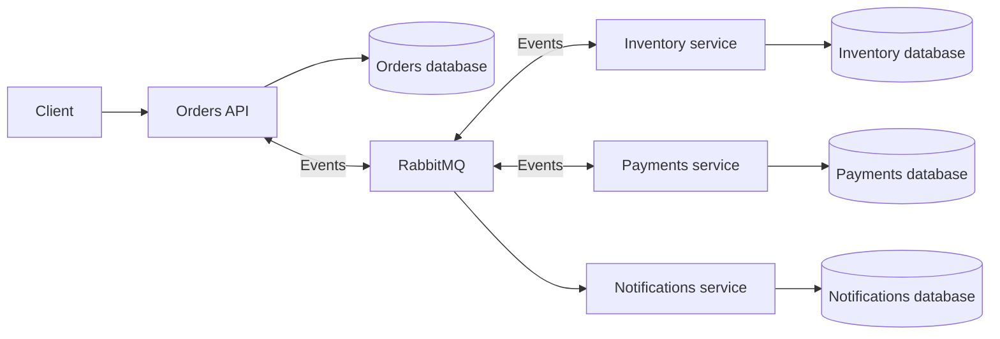

# Order processing platform

A portfolio backend exploring reliable asynchronous order processing with .NET 10,
RabbitMQ, and PostgreSQL. All business data will be fictional. The goal is to make
failure handling and delivery guarantees visible in the code.

## Current implementation

Phase a provides four service hosts, an Orders layer structure, health endpoints,
container builds, RabbitMQ, and four isolated PostgreSQL databases.
Order endpoints, messaging, persistence models, and telemetry are not implemented yet.

| Service | Local URL | Owned database |
| --- | --- | --- |
| Orders | http://localhost:5001 | orders |
| Inventory | http://localhost:5002 | inventory |
| Payments | http://localhost:5003 | payments |
| Notifications | http://localhost:5004 | notifications |

## Run locally

Prerequisites: Docker Desktop with the Linux engine and Docker Compose v2.
The .NET SDK is needed only for local builds and tests; `global.json` pins its version.

1. Copy `.env.example` to `.env` (`Copy-Item .env.example .env` in PowerShell).
2. Replace every password placeholder with a distinct local value. Keep `.env` private.
3. Run:

```sh
docker compose up --build --wait
```

Subsequent starts can use `docker compose up`. Compose builds missing images.
RabbitMQ management is available at http://localhost:15672 using the credentials
from `.env`. Published ports bind to the loopback interface only. Database and AMQP
ports are available only inside the Compose network.

Each host exposes `/health/live` and `/health/ready`. Currently these report host
health only; readiness will include dependency checks when clients are implemented.
Readiness fails during shutdown. Hosts allow 30 seconds for graceful shutdown;
Compose allows 40 seconds before terminating a service container.

```powershell
./scripts/Verify-Compose.ps1
```

The verification script checks all health endpoints and database ownership and
connection isolation. It requires running containers and PowerShell 7 or Windows PowerShell.

```sh
docker compose logs --follow orders
docker compose down
```

`down` retains data. Database initialization scripts run only on an empty PostgreSQL
volume. Editing passwords in `.env` does not rotate existing database or broker
credentials. For a disposable local reset, `docker compose down --volumes` deletes
**all project database and broker data**, after which Compose can initialize again.

## Build and test

```sh
dotnet restore OrderProcessingPlatform.slnx --locked-mode
dotnet build OrderProcessingPlatform.slnx --configuration Release --no-restore
dotnet test OrderProcessingPlatform.slnx --configuration Release --no-build
dotnet format OrderProcessingPlatform.slnx --verify-no-changes --no-restore
```

The initial xUnit suite uses ASP.NET Core's in-process test server to verify all four
hosts and that failing readiness checks do not break liveness. These tests require
no Docker. PostgreSQL/RabbitMQ Testcontainers tests will accompany their integrations.
Package sources are scoped to public nuget.org; package versions and dependency
lock files are committed. Warnings are treated as errors.

## Intended architecture

This diagram describes the target; only the host and infrastructure skeleton exists today.



## Design decisions and trade-offs

- Orders has separate Domain, Application, Infrastructure, and API projects. Smaller
  services begin as single deployable projects and gain internal folders as needed.
- Each service owns a database and login. One PostgreSQL container reduces local
  resource usage but shares infrastructure failure and capacity across services.
  Cross-service database connections are denied to service roles.
- Worker services use ASP.NET Core hosts so they expose standard HTTP health endpoints.
- Containers run as the .NET image's non-root application user. A small curl dependency
  allows Docker to probe actual HTTP readiness rather than merely process existence.
- Database passwords are separate configuration fields so later Npgsql connection
  string construction can safely handle special characters.
- Common transport and telemetry projects will be added when they have real code.
  Business models and persistence ownership remain local to each service.

## Known limitations and next steps

- This phase cannot place or process orders. Do not interpret healthy hosts as proof
  of working database connections or message delivery.
- Next: Orders API, EF Core/Npgsql migrations, and a handwritten transactional outbox.
- Subsequent phases add idempotent consumers, compensation, bounded retries, DLQ
  inspection/replay, OpenTelemetry with Grafana/Tempo/Prometheus, Testcontainers,
  GitHub Actions, failure scenarios, and ADRs.
- Authentication, TLS, secret management, backup/restore, and production deployment
  are outside the current local demo. Do not expose the Compose environment publicly.
- Container tags are version-scoped but not pinned to immutable digests yet.
- No performance measurements or benchmark claims have been made.
