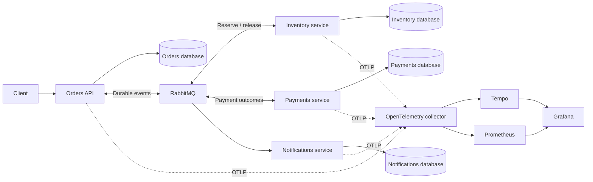
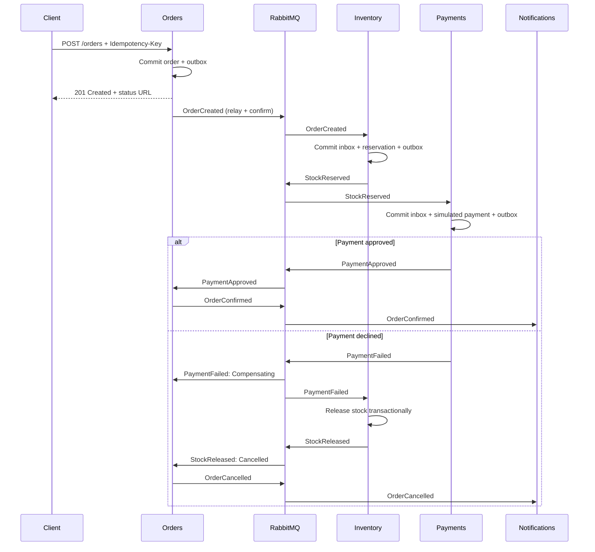

# Order processing platform

A .NET 10 backend demonstrating event-driven microservices under partial failure:
transactional outbox, idempotent consumers, compensating transactions, bounded retries,
dead-letter recovery, and distributed tracing. All products, prices, and orders are fictional.

Placing an order spans independent databases and a message broker. No single transaction
can atomically cover all of them. This project makes those failure boundaries visible
instead of claiming exactly-once delivery.

## Start here

Prerequisites: Docker with the Linux engine and Compose v2. Install the SDK pinned by
`global.json` for local builds and tests. PowerShell scripts work with Windows PowerShell
or PowerShell 7; CI uses PowerShell 7 on Linux.

```powershell
./scripts/Initialize-LocalEnvironment.ps1
docker compose up --build --wait
./scripts/Verify-Compose.ps1
./scripts/Demo.ps1
```

Environment initialization generates distinct local passwords in an ignored `.env`
without printing them. Alternatively, copy `.env.example` to `.env` and replace its
password placeholders. Existing `.env` files are never overwritten. After initial
configuration, **`docker compose up` starts the platform** and builds any missing images.

| Component | Local address |
| --- | --- |
| Orders API | http://localhost:5001 |
| Inventory health | http://localhost:5002/health/ready |
| Payments health | http://localhost:5003/health/ready |
| Notifications health | http://localhost:5004/health/ready |
| RabbitMQ management | http://localhost:15672 |
| Grafana | http://localhost:3000/d/order-platform |
| Prometheus | http://localhost:9090 |
| Tempo readiness | http://localhost:3200/ready |

Grafana uses `admin` and `GRAFANA_ADMIN_PASSWORD`; RabbitMQ uses `RABBITMQ_USER` and
`RABBITMQ_PASSWORD`, all from `.env`. Published ports bind to loopback. PostgreSQL and
AMQP are internal to the Compose network. Do not expose this local stack publicly.

## Architecture



One PostgreSQL container hosts four databases with distinct owners and credentials.
Service roles cannot connect to another service's database. Each service owns its
business tables, inbox, outbox, and EF Core migrations.



Insufficient stock produces `StockReservationFailed` and cancels directly, without
calling Payments. Technical retry exhaustion leaves the order pending for recovery;
it does not manufacture a business rejection.

## API and sample data

The fictional catalog uses USD and starts with 50 units per SKU:

| SKU | Unit price |
| --- | ---: |
| BOOK-DOTNET | 29.90 |
| MUG-EVENTS | 12.50 |
| SHIRT-ASYNC | 24.00 |

```sh
curl -i http://localhost:5001/orders \
  -H 'Content-Type: application/json' \
  -H 'Idempotency-Key: demo-order-001' \
  -d '{"lines":[{"sku":"BOOK-DOTNET","quantity":1}]}'

curl http://localhost:5001/orders/REPLACE_WITH_ORDER_ID
```

Use `curl.exe` in Windows PowerShell, where `curl` can be an alias. A new request
returns 201 and a Location header. An identical request with the same key returns
200 and the existing order; changed content returns 409. Missing keys, unknown SKUs,
and invalid quantities return 400. Each request accepts 1–20 lines, with at most
100 units per SKU after duplicate lines are grouped. Prices are calculated server-side.

Optional `X-Correlation-Id` accepts a nonempty UUID; otherwise one is generated and
returned. W3C `traceparent` and `tracestate` propagate through the HTTP request and
every integration event. Message, correlation, and causation IDs have distinct roles.

States: PendingInventory → AwaitingPayment → Confirmed, or Compensating → Cancelled.
Authoritative outcomes tolerate a delayed StockReserved event from another publisher.

## Failure scenarios and dead letters

| Setting in .env | Behavior |
| --- | --- |
| PAYMENT_FAILURE_RATE=0 | Approve every simulated payment |
| PAYMENT_FAILURE_RATE=1 | Decline every payment; release stock before cancellation |
| PAYMENT_TRANSIENT_FAILURES=2 | Fail the first two processing attempts, then continue |
| PAYMENT_TRANSIENT_FAILURES=10 | Exhaust retries and send to the Payments DLQ |

After editing payment settings, run `docker compose up -d --force-recreate payments`.
Payment rejection is deterministic per order and is distinct from a temporary provider
exception. There are no real payment details or external charges.

```sh
docker compose run --rm --build deadletter inspect payments 1
# Repair configuration or the underlying fault first, then:
docker compose run --rm deadletter replay payments 1
```

The CLI supports all four service names and counts from 1 to 100. Inspection requeues
messages without acknowledging; replay preserves identity and targets only that
consumer. See the [failure runbook](docs/runbooks/failure-scenarios.md) for complete
success, compensation, retry, DLQ, replay, and broker outage demonstrations.

## Observe the workflow

Grafana provisions Prometheus, Tempo, and the **Order processing reliability** dashboard.
It shows pending outbox messages, processed events, retries, dead-letter forwarding,
and deduplication. Counters appear after their first relevant event.

In Grafana Explore, select Tempo and search:

```text
{ resource.service.name = "orders" }
```

Open a POST trace to follow producer/consumer spans through Inventory, Payments, Orders,
and Notifications. Search by the `correlation.id` span attribute to connect related
attempts. Health requests are excluded from tracing. Structured JSON logs include
event, message, correlation, and attempt fields. No order IDs are metric labels.

`/health/live` checks the process; `/health/ready` checks database connectivity and
the broker connection, and fails during shutdown. Hosts allow 30 seconds to stop;
Compose allows 40. An interrupted unacknowledged delivery is retried by the broker.
Telemetry failure does not roll back business transactions.

## Build, test, and check publication safety

```sh
dotnet restore OrderProcessingPlatform.slnx --locked-mode
dotnet build OrderProcessingPlatform.slnx --configuration Release --no-restore
dotnet test OrderProcessingPlatform.slnx --configuration Release --no-build
dotnet format OrderProcessingPlatform.slnx --verify-no-changes --no-restore
```

Tests use xUnit, ASP.NET Core TestServer, and disposable PostgreSQL/RabbitMQ containers.
Docker must be available for integration tests. They do not use or reset Compose data.
Coverage includes concurrent duplicate delivery, HTTP idempotency conflicts, stock
contention, partial-reservation rollback, payment deduplication, inbox rollback,
publish-before-dispatch-commit failure, retry exhaustion/replay, and full choreography.

```powershell
./scripts/Check-TrackedFiles.ps1
./scripts/Scan-Secrets.ps1
```

The scanner receives only a Git history bundle in a container with networking disabled.
It never mounts the working tree, ignored `.env`, or Git credential configuration.
`.gitignore` and `.dockerignore` exclude private settings, local launch profiles,
certificates, keys, dumps, and diagnostics. Ignoring a file does not untrack it or
remove historical secrets; the tracked-file guard and history scan cover those gaps.

GitHub Actions runs restore, build, formatting, Testcontainers tests, secret checks,
and a Compose smoke test. The workflow is committed; a remote run requires pushing
to a GitHub repository. No CI success badge is claimed before that happens.

## Design decisions and trade-offs

- **Visible outbox:** business changes and events commit together. The relay uses
  FOR UPDATE SKIP LOCKED and confirms. Publish-before-dispatch-commit can duplicate
  delivery; the tests reproduce this window.
- **Local inbox:** the unique consumer/message key, handler changes, and outgoing
  events share one transaction. Business keys also protect semantically repeated events.
- **Choreography:** appropriate for this short workflow; more steps, deadlines, or
  manual approvals could justify an orchestrator.
- **Bounded retry queues:** quorum TTL queues delay retries by 1, 5, and 15 seconds.
  At-least-once dead lettering and confirmed forwarding protect broker handoffs.
- **Small transport layer:** shared mechanics, no generic repositories or shared
  business entities. Orders uses project boundaries; smaller services use one project.
- **Polling consumers:** one message at a time keeps channel ownership and transaction
  boundaries obvious. Throughput is intentionally limited; this is not a benchmark.
- **Local migrations at startup:** convenient for a reproducible demo. Production
  releases should run reviewed migrations as a separate deployment step.

Rationale and consequences live in [docs/adr](docs/adr).

## Known limitations and next steps

- No authentication, authorization, public deployment hardening, TLS, real charges,
  or real notification delivery. Use only on a trusted local machine.
- No workflow deadlines or automatic reconciliation of stranded orders; DLQs require
  operator intervention. Refunds, post-payment shipping failures, and client cancellation
  are outside the implemented workflow.
- Local database effects are idempotent; arbitrary external effects are not exactly-once.
  A simulated notification log can repeat if the transaction later rolls back.
- No inbox/outbox retention jobs, automatic poison-outbox quarantine, event upcasters,
  jitter, or circuit breaker. Batches hold database locks while awaiting confirms.
- Strict global event ordering is not provided. Pending outbox counts are periodically
  sampled; broker connection health does not prove business progress.
- One broker and one PostgreSQL container share local failure domains; quorum queues
  on one node do not demonstrate replicated high availability.
- Tempo traces use temporary storage and disappear on container recreation. Metric and
  Grafana volumes persist. Telemetry queues are best effort and may drop data on outages.
- Infrastructure images are version-tagged rather than fully digest-pinned. The secret
  scanner is digest-pinned. Production would require image scanning and upgrade policy.
- No load test results or performance numbers are claimed.

Stop without deleting data using `docker compose down`. A disposable reset with
`docker compose down --volumes` deletes all local database, broker, Grafana, and metric
data. Initialization credentials apply only to empty volumes; editing `.env` is not
credential rotation.
