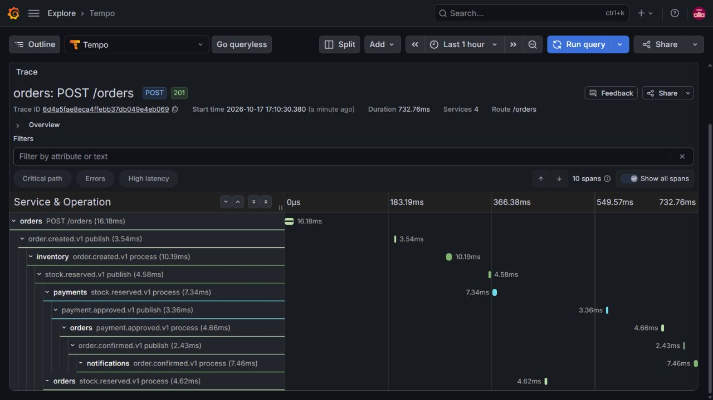
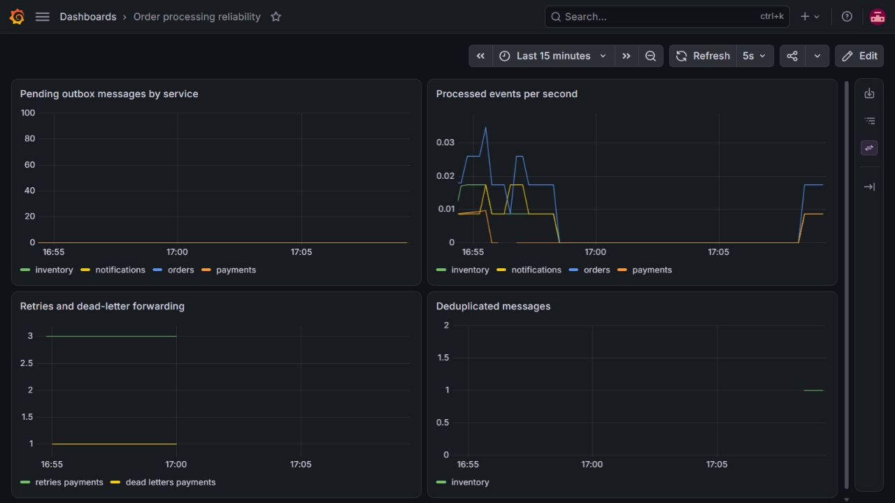

# A five-minute engineering demonstration

Use this walkthrough to explore order processing, failure recovery, and distributed
tracing. The screenshots show
real local events with fictional data; they are not load-test results.

## Preparation

1. Start Docker and run `docker compose up --build --wait`.
2. Open Grafana at http://localhost:3000 and sign in using the local .env credentials.
   Keep the login form and .env off screen when sharing.
3. Open the reliability dashboard and a Tempo Explore tab.
4. For a deterministic successful order, set PAYMENT_FAILURE_RATE=0 and
   PAYMENT_TRANSIENT_FAILURES=0 in .env, then run
   `docker compose up -d --force-recreate --wait payments`.

## Minute 1: explain the problem

“Creating an order involves independent databases and a broker. The project focuses
on what happens if a process crashes between those operations. It uses local
transactions and expects at-least-once delivery.”

Show the architecture diagram in the README. Each service owns its database; the
single local PostgreSQL container is a development convenience, not proof of isolation
from infrastructure failure.

## Minute 2: place an order and follow the trace

```powershell
./scripts/Demo.ps1 -Expected Confirmed
```

The script prints the order ID, correlation ID, and a W3C trace ID. In Grafana Explore,
select Tempo, choose TraceQL, paste that trace ID into the editor, and run the query.
The data source recognizes a raw trace ID as a direct trace lookup.
Show the HTTP request, event publishers, and consumers across all four services.

“A correlation ID connects the business workflow. A trace ID connects execution spans.
The message ID identifies a particular event, and the causation ID points to the event
that produced it. These are intentionally separate.”

## Minute 3: show the correctness boundary

Open [OrderStore](../src/Orders/Orders.Infrastructure/OrderStore.cs), then
[OutboxRelay](../src/BuildingBlocks/Messaging/OutboxRelay.cs).

“The order and outgoing event commit together. The relay locks a small batch, waits
for publisher confirmation, and commits dispatch timestamps. If publishing succeeds
but the database commit fails, the same message ID can be published again.”

Open [InboxProcessor](../src/BuildingBlocks/Messaging/InboxProcessor.cs).

“The inbox claim and business changes use one transaction. A unique constraint also
handles concurrent duplicates. If processing fails, the claim rolls back and the next
attempt can run.”

## Minute 4: demonstrate a business failure

Set PAYMENT_FAILURE_RATE=1 and PAYMENT_TRANSIENT_FAILURES=0, recreate Payments, and run:

```powershell
./scripts/Demo.ps1 -Expected Cancelled
```

“A declined payment is a business outcome. Inventory releases the reservation before
Orders becomes Cancelled. A technical outage instead receives bounded retries and
can leave an order pending for operator recovery.”

For a longer session, use the [failure runbook](runbooks/failure-scenarios.md) to show
the 1/5/15-second retry stages, dead-letter inspection, and targeted replay. Repair
the failure before replaying; keep the original message identity.

## Minute 5: show evidence and limits

Show the CI check and the tests around stock contention, inbox rollback, and the
publish-before-dispatch-commit window. The quorum queues use one local node, so this
does not demonstrate replicated broker availability. Notifications are simulated,
and a real provider would need its own idempotency and reconciliation strategy.

Close with the implemented trade-offs: polling favors readable transaction boundaries
over throughput; outbox retention and workflow timeouts remain future work. Do not
claim exactly-once external effects or performance numbers.

Restore the intended local payment settings after the demonstration.

## Recorded trace



The spans show a single successful local request and its asynchronous follow-up work.
The displayed durations are observations of that request, not a performance guarantee.

## Recorded dashboard



This capture includes an actual duplicate delivery detected by Inventory. Counter
values reflect that local exercise; they are not capacity measurements.
